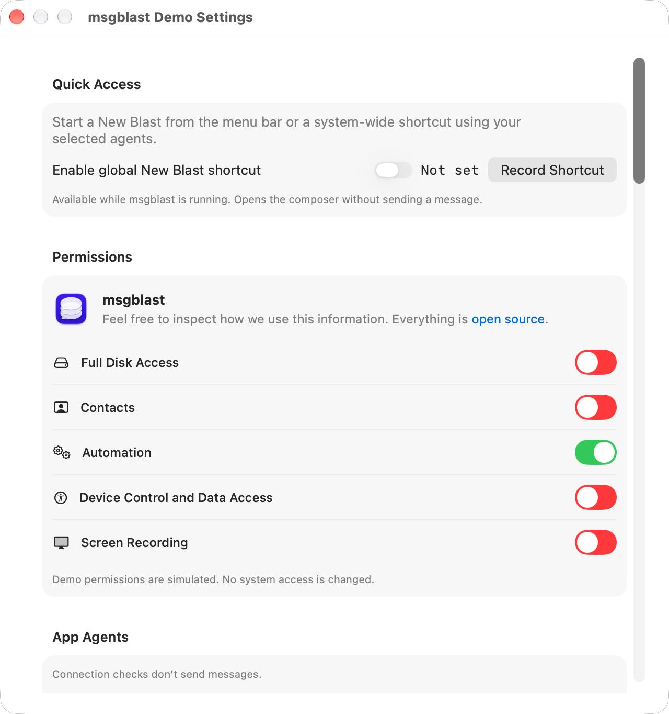
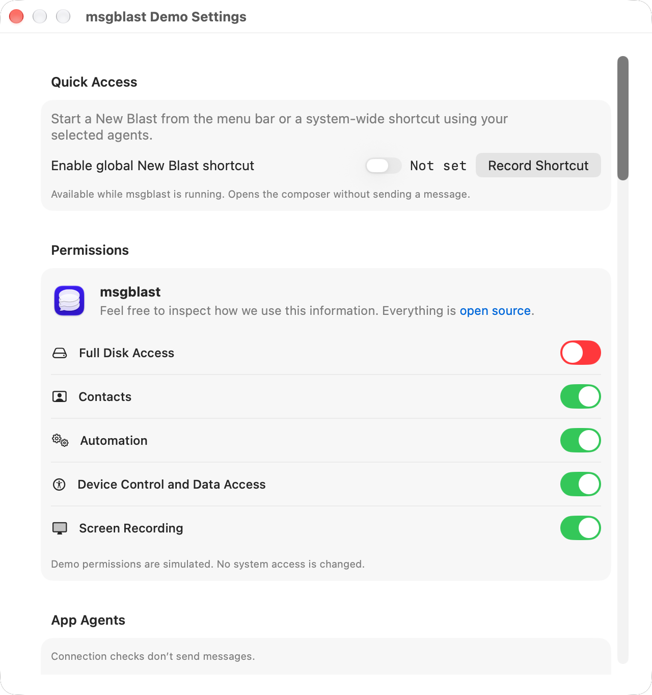
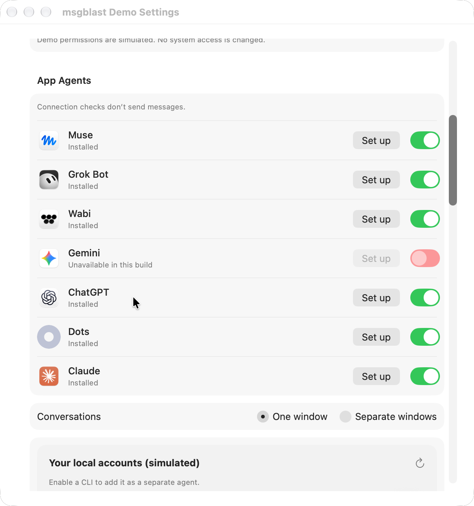
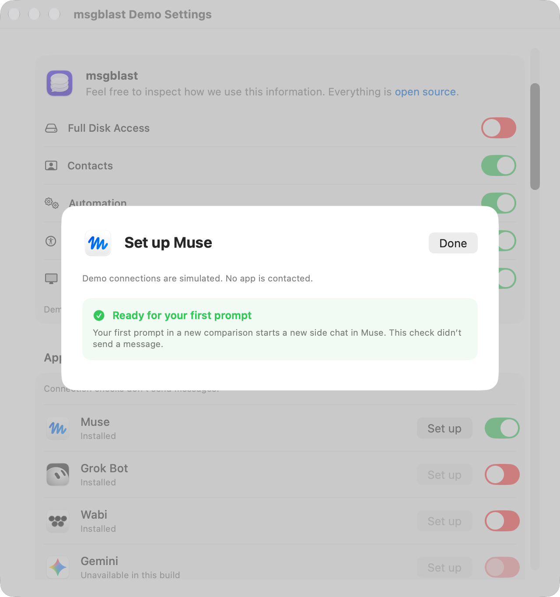
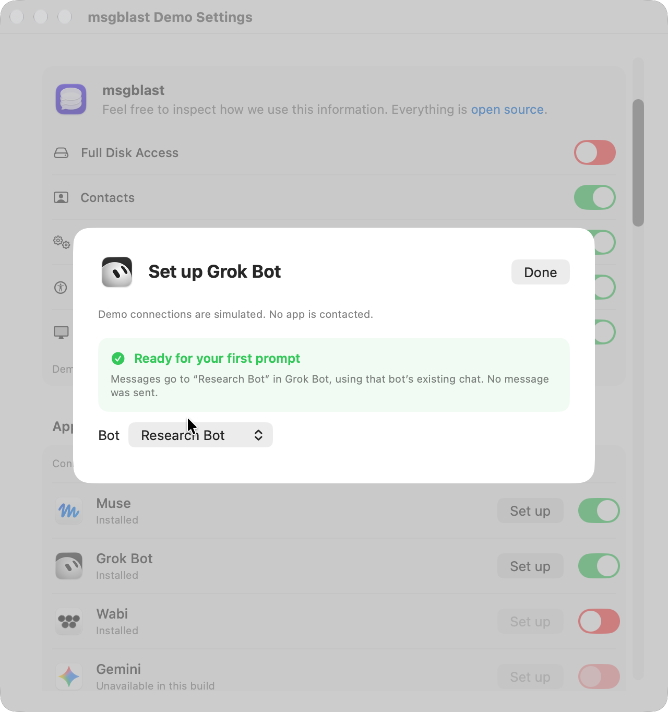
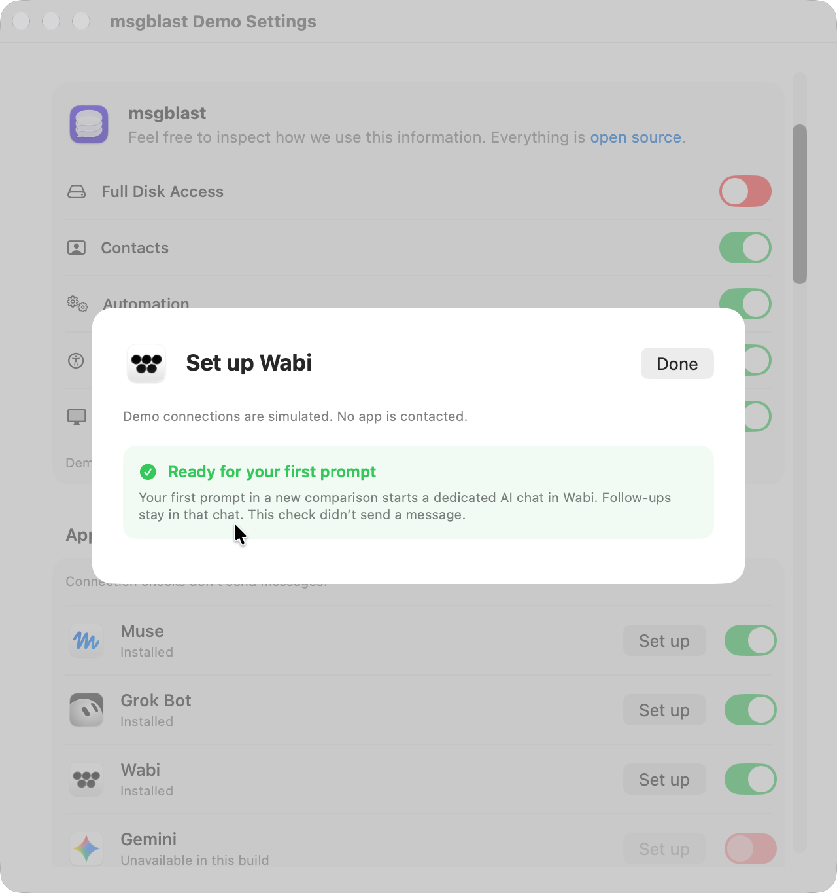
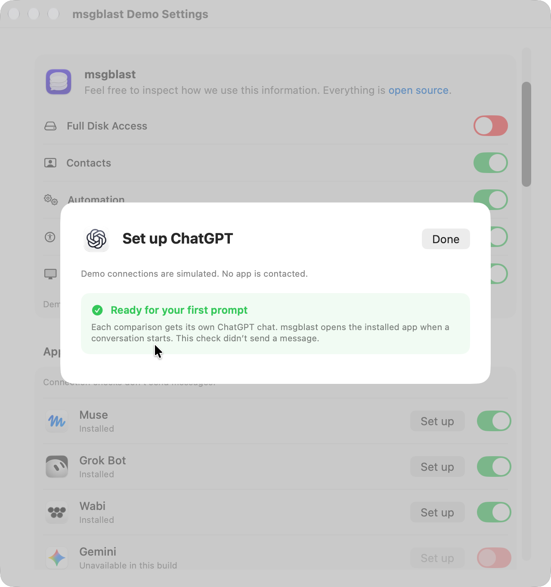
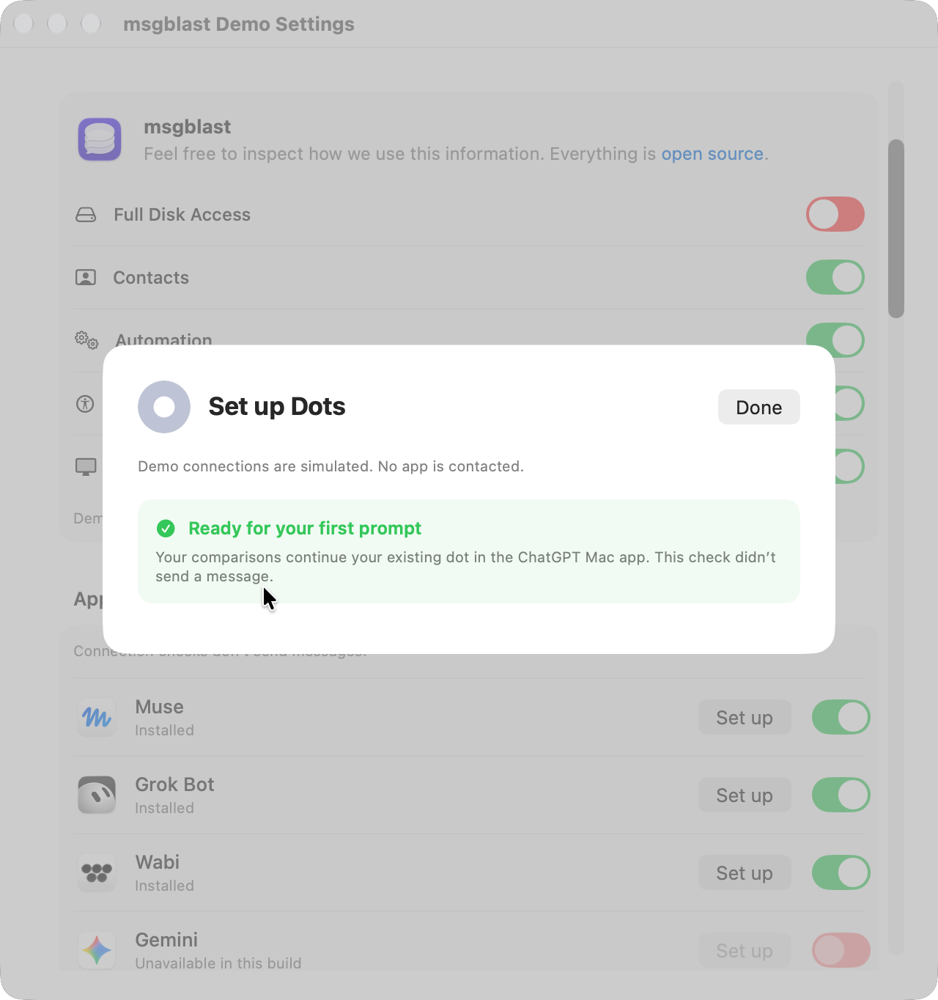
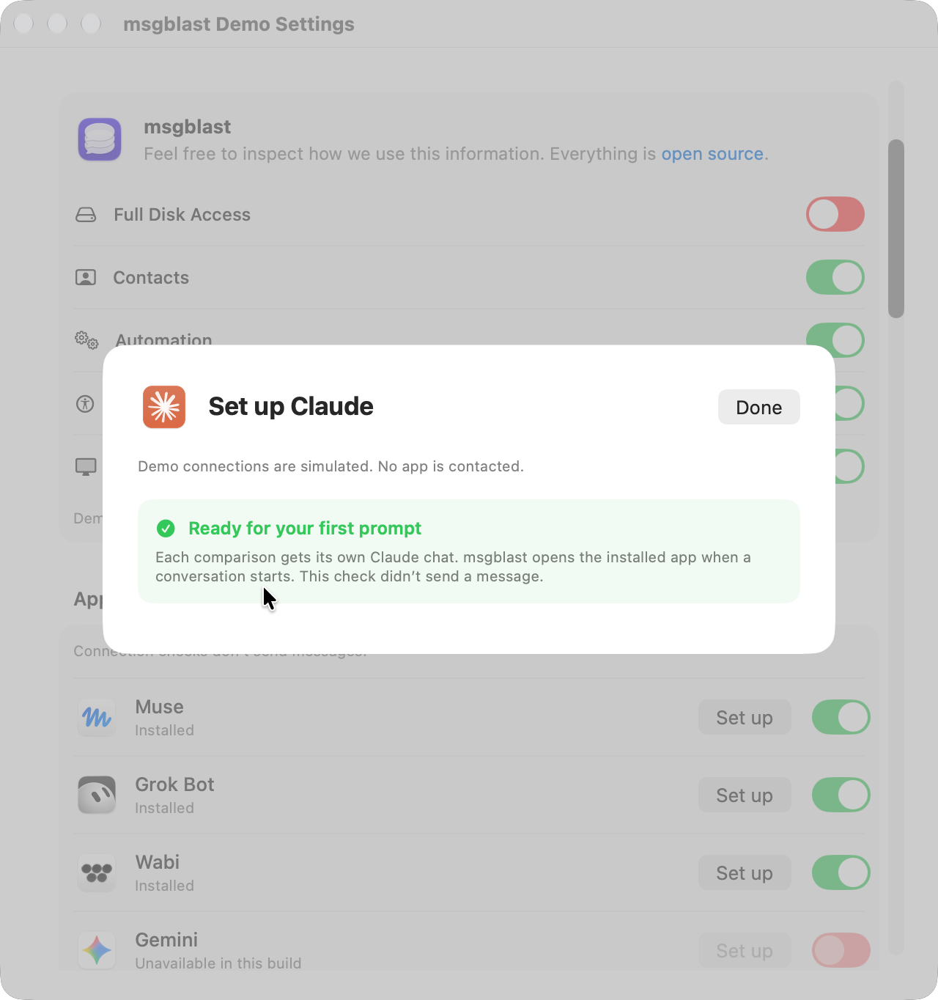
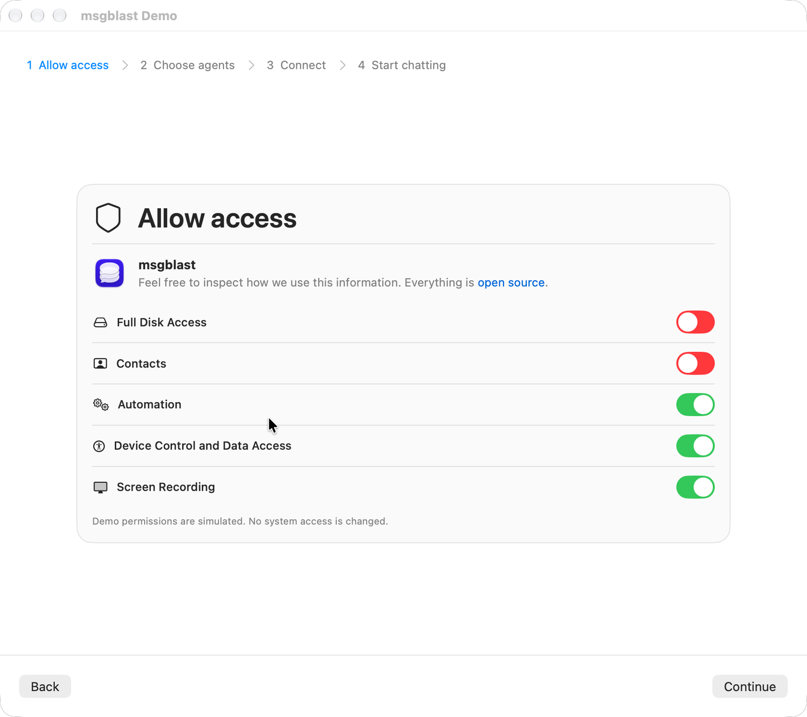

# PR 79 Settings evidence

Source: `80795eac0e581b90972fd04b1c8942f226a8cfe8`.

Native blue **msgblast Demo**, built from the clean committed revision and run on the dedicated Mac. All permissions, installations and connections in these images and video are simulated. No OS access was changed and no real app was contacted. Gemini remains unavailable. There is no mobile layout.

The 38.2-second [walkthrough](settings-setup.mp4) is a continuous native recording at **4x speed**, cropped to the exact Settings window, without cuts or audio. It is not a screenshot sequence. [GitHub player](https://github.com/user-attachments/assets/e441e398-2a85-4bc7-8cec-ea5451c9baba).

## Results

- All five shared permission switches appear in Settings.
- Contacts enables independently of Full Disk Access.
- Enabled ChatGPT cannot enter setup with both app grants off, or host access alone; setup becomes available after capture access.
- All six available setup sheets reach Ready. Grok Bot uses the chosen Research Bot.
- The exact unsent draft survives, with no comparison created and no onboarding restart.
- Shared onboarding waits for both app grants, updates Continue without manual refresh and reaches agent selection; its permission page fits without scrolling.
- A separate read-only check of live Dev from the same revision confirms installation guards and real status display. Existing completed onboarding, drafts, selections, comparisons, agents, grid and all 17 session files remain semantically unchanged. No live connection, message or permission action was attempted in that check.

57 affected native regressions, nine permission-controller fixtures and the web/session controller harness pass. The two changed UI regressions compile, but the local XCTest automation runner timed out before starting assertions. These direct UI checks are separate evidence. New real macOS grants, failed-save/restart paths and VoiceOver are not proven by Demo fixtures.

## Screenshots

| Before simulated grants | After independent grants |
| --- | --- |
|  |  |

| Muse | Grok Bot picker |
| --- | --- |
|  |  |

| Wabi | ChatGPT |
| --- | --- |
|  |  |

| Dots | Claude |
| --- | --- |
|  |  |

