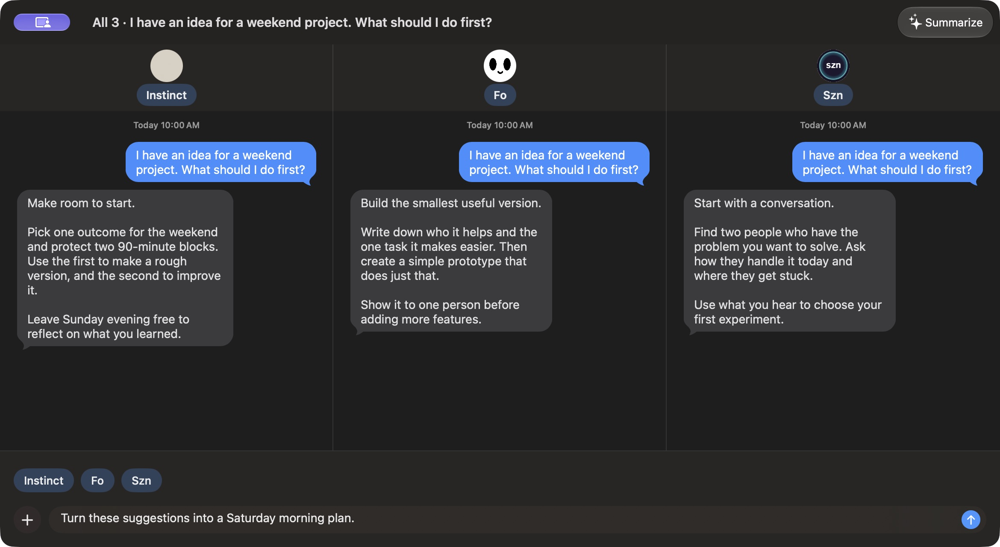

  

<h1 align="center">msgblast</h1>

<strong>Ask once. Compare the answers.</strong>

Send one question to AI assistants in native Mac apps, Messages, websites, and local CLIs. Compare their replies side by side.

<a href="https://updates.msgblast.app/latest.zip"><strong>Download for Mac</strong></a> · macOS Sequoia 15 or later

Planning a weekend, researching a purchase, or testing an idea? Write your question once, choose your agents, and compare their suggestions in one window. Follow up with everyone or just one agent. Your comparisons stay saved so you can return to them later.

*Actual Messages comparison captured from an earlier app version. The replies are illustrative sample text.*

## Features

- **App Agents and Messages Agents together.** Compare installed Mac assistants and the agents you already text. Optional websites and CLI conversations can join the same blast.
- **Prompts and replies in one place.** See your outgoing message, submission status, and each agent’s reply in msgblast. Follow-ups stay with the original conversation.
- **Keep going while agents are busy.** Responding agents show **Busy** and are unavailable for another selection. Send to ready agents without manually deselecting the busy ones; their saved choices stay intact.
- **Saved comparisons and drafts.** Reopen a comparison from the sidebar, continue its conversations, or start a **New Blast** without losing an unsent prompt. Replies that arrive later stay attached to the original comparison.
- **Simpler setup.** Review access, choose agents, and connect them. Setup remembers progress across permission restarts, and the same permission controls and App Agent setup are available in Settings.
- **Your accounts.** Use the account signed in to each native app, add named website accounts for work and personal use, or enable Codex CLI and Claude Code separately.
- **Rich Messages.** Send photos and files to Messages Agents and read attachment previews, link cards, and reactions. Generate a comparison report from their replies.
- **Quick access and discovery.** Start a blast from the menu bar or a configurable keyboard shortcut. Find more assistants in Discover, and revisit changes from the sidebar’s **What’s New** panel.
- **Feedback you control.** Review eligible crash summaries before choosing to send one privately to the msgblast team. Manage optional usage and app-health sharing in Settings.

## Supported agents

### App Agents

Install and sign in to the native Mac app, then enable it in onboarding or **Settings → App Agents**. Your service’s account, subscription, and usage limits still apply.

| Agent | Conversation in the native app |
| --- | --- |
| **ChatGPT** | A dedicated ChatGPT chat for each comparison. |
| **Dots** | Your ongoing **Your dot** conversation inside the **ChatGPT app**. A Dot must already be set up and available in your account; no separate Dots app is needed. |
| **Claude** | A dedicated Claude chat for each comparison. |
| **Muse** | A dedicated Muse side chat for each comparison. |
| **Grok Bot** | Choose a bot in msgblast. Prompts continue that bot’s existing conversation across comparisons. Separate from the Grok website. |
| **Wabi** | A dedicated Wabi AI chat for each comparison. |

Choose **ChatGPT or Dots**, rather than both in the same blast: they share the ChatGPT app. Dots availability depends on the signed-in account. Native **Gemini is deferred** and cannot be connected in this build.

msgblast opens a closed app when you explicitly connect or start a conversation. Apps can remain on other macOS desktops. Some apps briefly come forward for message entry and submission; **focus returns to msgblast** while it collects the reply. Existing drafts and active responses are preserved. Connection checks never send a test prompt.

See [desktop app conversations](docs/desktop-app-conversations.md) for setup, conversation behavior, and compatibility limits.

### Messages Agents

Connect existing one-to-one iMessage conversations with assistants such as **Instinct, Fo, Szn, Poke, and tinyNature**. With Messages permissions enabled, eligible existing agent conversations are added automatically during setup; deselect any you don’t want. Discover helps you find more agents.

Messages Agents support photos and files. Attachments are available for a shared blast when **only Messages Agents** are selected; blasts that include apps, websites, or CLIs use text.

### Websites and other connections

| Connection | Agents | Availability and behavior |
| --- | --- | --- |
| Optional websites | **Muse Web, ChatGPT Web, Claude Web, Grok Web, Dots Web** | Enable in **Settings → Web agents**. These alternatives are hidden from onboarding. Website sign-ins and conversations are separate from native app accounts. Dots continues the account’s dot conversation. |
| Other websites | **rabbit OS3 Web, Hark Web** | rabbit OS3 continues one account-wide conversation across comparisons. Hark supports manual chat in its own pane; it does **not** receive shared blasts. |
| Optional CLI conversations | **Codex CLI, Claude Code** | Enable in **Settings → Your local accounts**. Use installed, signed-in CLIs with their own saved conversations and configured capabilities. |
| Optional Grok Bot webhook | **Grok Bot** | A separate connection from both the native Grok Bot app and Grok Web. Configure a bot’s routine and reply connection in Settings. [Webhook setup and limits](docs/grokbot.md). |

For **Muse Web, ChatGPT Web, Claude Web, and Grok Web**, add separate named accounts in Settings or duplicate an agent with a shared sign-in. Each agent keeps its own drafts and conversations. Native apps use the account currently selected in that app. See [multiple accounts](docs/multiple-accounts.md).

CLI chats respect the installed CLI’s permissions, skills, tools, and connectors. Interactive approvals may require Terminal; msgblast does not bypass them. Claude Code requires **2.1.259 or later**. Website sign-in does not sign in a CLI. See [CLI accounts and conversations](docs/personal-agent-reports.md#website-chats-and-optional-cli-conversations).

### Comparison report agents

**Codex, Claude Code, Gemini CLI, Pi, and Hermes** can generate reports from Messages comparisons. These are separate from chat agents: report generation restricts tools to analyzing the supplied replies. **Hermes** offers reports and Terminal setup, without a chat pane. **OpenClaw** currently offers a Terminal setup shortcut only, with no chat or report integration.

## Get started

1. [Download msgblast](https://updates.msgblast.app/latest.zip), unzip it, and drag **msgblast.app** into **Applications**. Open the app.
2. Choose your optional statistics-sharing preferences, then review **Allow access**. Enable the permissions you want, or choose **Skip for now**. Setup saves your progress before macOS permission changes and resumes after a restart.
3. **Choose your agents.** Install and sign in to the Mac apps you want to use. Eligible Messages Agents are added from your existing conversations when access is ready.
4. **Connect your agents.** Use each selected app’s **Connect** action, and choose a bot for Grok Bot. One action checks installation, opens the app if needed, and checks readiness without sending a message.
5. Write your question and press send. Compare the replies, choose recipients for a follow-up, or click **New Blast**. Saved comparisons remain in the sidebar.

You can set up more apps later in **msgblast → Settings → App Agents**, and review access in **Settings → Permissions**. Enabled apps with a known destination can prepare on their first prompt without a separate Connect click; Grok Bot needs a chosen bot first.

### Permissions

All permissions belong to **msgblast**. App control is bundled; you do not need to install or approve a separate helper app.

| Permission | What it enables |
| --- | --- |
| **Full Disk Access** | Read your local Messages history to find conversations and display replies. msgblast does not modify the Messages database. |
| **Contacts** | Find your saved agents and save contacts when you explicitly add one. |
| **Automation → Messages** | Send through Apple’s Messages app. |
| **Device Control and Data Access** (**Accessibility** on older macOS) | Read and operate native agent app controls. |
| **Screen Recording** | Capture native app windows where needed for app control. This is separate from sharing recordings or analytics. |

**Continue** on Allow access requires all five permissions. **Skip for now** remains available; agents that need missing access cannot connect. Permission status refreshes automatically when you return from System Settings. After a permission restart, setup returns to Allow access with your progress intact. If required access is missing at a later launch, the permission flow resumes unless you previously skipped it.

Help with macOS access and first launch

Use the switches in **Allow access** or **Settings → Permissions** to open the matching macOS controls. For Full Disk Access, app control, and Screen Recording, follow the app’s drag-to-Settings guidance and enable **msgblast**. Accept macOS’s restart instructions when offered. For Automation, enable **Messages** under msgblast. Opening System Settings alone does not grant access.

For Messages, start a one-to-one iMessage conversation with the assistant first. Eligible conversations are discovered during setup; you can also add an agent using its exact name, email, or phone number. A missing or unsupported conversation is not treated as connected.

Production downloads are Developer ID signed and notarized. If macOS still blocks a trusted download, follow [Apple’s first-launch instructions](https://support.apple.com/en-us/102445#openanyway). Local Dev/Demo previews have their own signing and permission identities; see [Build from source](docs/build-from-source.md).

## Messages comparisons and reports

Messages comparisons can stay in one window or use separate conversation windows with a floating shared composer. Choose the layout in **msgblast → Settings → Conversations**.

Click **Summarize** in a Messages comparison to generate a **Comparison report** covering shared findings, complementary contributions, differences, and open questions. Reports use an installed, configured report agent and the available Messages replies and reactions. App, website, and CLI chat replies are not included; attachment contents are not sent to the report agent.

Reports are saved with the comparison and update when you request it. See [comparison reports and local agents](docs/personal-agent-reports.md), including [OpenClaw and Hermes setup](docs/personal-agent-reports.md#openclaw-and-hermes-terminal-setup).

## Privacy, feedback, and updates

Comparisons and drafts are saved on your Mac. Prompts go to the services you select; each service keeps its own account and data policies. Messages history access is read-only. App, website, CLI, and webhook sign-ins remain separate.

Choose **Help → Review Crash Reports…** to inspect eligible crash summaries and optionally send one privately. Nothing in that workflow uploads until you choose **Send crash report**. Summaries exclude raw crash files, paths, messages, and contacts; review any context you add yourself. See [crash reporting](docs/crash-reporting.md).

Optional usage and app-health statistics are controlled in **Settings → Sharing**. Conversations and screen recordings are not collected by analytics. All app features work with sharing off.

Use **msgblast → Check for Updates…** or **Settings → Updates** for app updates. **What’s New** in the sidebar shows the changes in your installed version. [Release notes](release-notes) record the published updates.

## Current limits

Native app and website updates can change their controls and affect compatibility. If submission is uncertain, msgblast preserves the request and does not automatically resend it. Keep the Mac awake and msgblast open while waiting for replies. Choose models and thinking settings in each service’s own controls; there is no shared model or thinking selector.

## Build your own feature

Choose **msgblast → Build a New Feature…** to describe your idea and copy a
starting prompt for your coding agent. The window links to the public repository,
fork page, source download, and build guide. You can also find it in **Help**.

[msgblast's source is public](https://github.com/mgalpert/msgblast). Fork it, build
the feature you want to use, and share it through a pull request with a description,
screenshots, and a short video. You can also clone or download the source for a
personal build.

Start with [Build from source](docs/build-from-source.md) to create separate
**msgblast Dev** and **msgblast Demo** apps without replacing your installed app.
Local previews need Xcode 27 and Python, but no production release credentials.
Use Demo with sample data for testing and recordings; Dev uses live accounts.

[Contributing](CONTRIBUTING.md) covers forks and PRs.
[Architecture](docs/architecture.md) maps the codebase, [Testing](docs/testing.md)
lists checks, and the [documentation index](docs/README.md) links the current
integration and maintainer guides. Coding agents should read [AGENTS.md](AGENTS.md).

You can use your own build while your contribution is reviewed. Maintainers
publish reviewed changes separately; merging source does not distribute an app.

## License

Copyright (C) 2026 Michael Galpert and contributors.

Except where separately licensed or attributed, msgblast is licensed under the
[GNU General Public License, version 3 only](LICENSE) (`GPL-3.0-only`). You may
use, modify, and redistribute it, including commercially, under those terms.
Distributed modified versions must remain under GPLv3 and include the
corresponding source as required by the license. The software comes without
any warranty.

Third-party dependencies, service icons, logos, and other attributed assets
retain their respective licenses and rights; this license does not relicense
third-party material or grant trademark rights.
