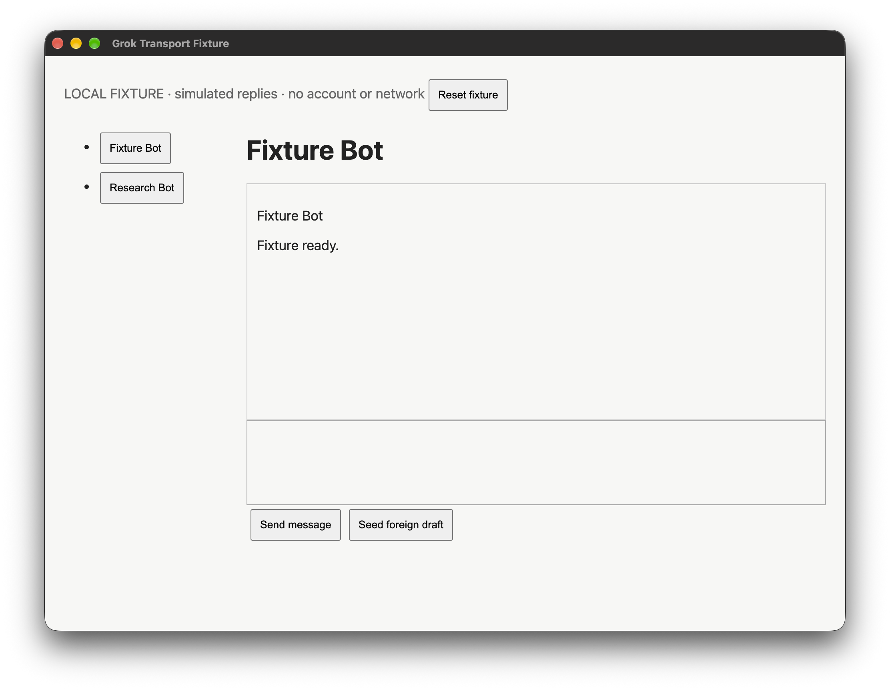
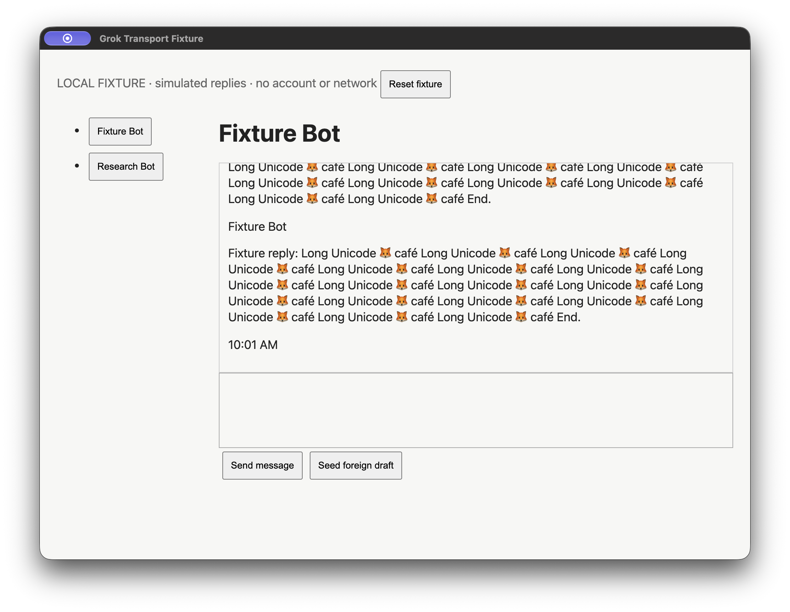

# Grok Agent Desktop comparison — 2026-10-31

Agent Desktop can run the existing native Grok Bot workflow through a Debug-only
opt-in adapter. This experiment does **not** support replacing Cua by default:
the measured CLI adapter is slower, and packaged permission/lifecycle validation
is incomplete. No fork was needed for the functional port. A focused fork or
in-process FFI integration remains an option for owned host lifecycle and fewer
CLI/discovery calls.

Base-SHA: 08e29ee679058b2513abe9ebad6288f2a7c301cb

Captured-Code-SHA: 95d25599ab5e67a6ba0cf931ed4e3add6ded2b51

The final evidence commit adds only this report and captured artifacts. Native
app/core code was built at 8fc745c876a001441ebdb0cd214d79e396b1a044; the subsequent
95d2559 change corrects the benchmark harness to include real discovery cost.
Both benchmark runs report clean source. The preview is local, ad-hoc signed,
blue-green msgblast Dev, updates disabled; it is not a production release.

## Measurements

| Workload | Cua 0.38.0 | Agent Desktop 1.0.2 |
| --- | ---: | ---: |
| Simulated native send-to-reply median, 5 samples | 10.073 s | 11.909 s |
| Send-to-reply range | 8.861–10.212 s | 11.232–12.162 s |
| Real Grok read-only snapshot median, 15 samples | 89.932 ms | 118.953 ms |
| Real Grok snapshot p95 | 104.981 ms | 129.822 ms |
| Accepted observations with one composer | 15/15 | 15/15 |

Agent Desktop's workflow median is 18.2% slower in this run. These are small,
single-machine samples, not a general performance claim about either library.
The workflow includes real app discovery, CLI startup, exact-window validation,
input/readback, submission and stable reply polling. Only the isolated fixture's
provider identity is rewritten, with real providers filtered out. Bot setup and
receipt recovery are verified outside each timed reply call. Both drivers use
100 ms polls and 300 ms stability instead of production's one/three seconds.
The fixture returns immediate simulated replies and blocks network requests:
there are no live sends, model latency or paid requests. Cua runs first; five
samples are sequential per driver. No external screenshots or recording ran
during timing. See [raw workflow samples](workflow-summary.json) and
[scenario results](workflow-results.txt).

Read-only observations alternate drivers on the same installed Grok window,
exclude one warm-up per driver and request depth 40 without screenshots. Cua's
compact tree and Agent Desktop's full tree are different work. Only timings and
counts are retained in [observation samples](observation.json); no conversation
text is published. Real bot discovery, independent AX identity agreement,
composer/history readiness, exact Grok focus and return to the isolated Dev
window also passed, with bot and draft unchanged. Live submission was not tested.

An earlier exploratory harness bypassed discovery and suggested Agent Desktop
was faster. That biased result is superseded by the discovery-inclusive run here.
Cold exploratory long-text/leading-newline runs sometimes made Cua safely refuse
with a preserved draft. Both separate edge probes passed in the final run;
that does not establish reliability across cold starts or every input length.

## Functional coverage and validation

Both drivers passed bot discovery/switching, multiline Unicode and blank lines,
repeated identical prompts with distinct fixture timestamps, single submission,
exact reply readback, serialized receipt recovery, read-only setup with a foreign
draft, refusal to overwrite that draft, and sending to another bot while
preserving it. Leading-newline and long chunked Unicode probes passed separately
and are excluded from latency.

229 native shared workflow/driver/conversation and transport tests passed at
956ac3e103f082b6e0e8d5583043efe84310ecfa. Another 161 ChatGPT, Gemini and Claude
native tests passed. After adding the foreground-only guard, all six transport
tests passed; that final core revision was used by the benchmark. Python compile,
JavaScript syntax and git whitespace checks passed. The generated Xcode project
includes both new Swift files. The isolated Dev preview built and passed signing
verification, preserving the production icon/app/state.

## Screenshots

These are actual native-window captures of the Electron 45.2.1 **local fixture**,
not the real Grok account or msgblast Demo. Demo bypasses native transports, so
this separate fixture exercises the actual adapter and shared workflow. Desktop
only: no responsive/mobile UI changed.

## Video

[Play the native Agent Desktop workflow](workflow.mp4).

Recorded separately from timing at Captured-Code-SHA, at original speed, without
audio, capturing only the fixture window. It demonstrates native typing, bot
switching, simulated replies and draft preservation. Recording results are in
[recorded-scenario-results.txt](recorded-scenario-results.txt). Recorded timings
are not used in the comparison.

ScreenCaptureKit's recording indicator created a 66 × 20 frontmost window that
Cua's exact-window focus check refused in an exploratory recording. Therefore
this video uses Agent Desktop only; the Cua comparison is the unrecorded run.

## Remaining adoption work

The isolated packaged test app reached the macOS Touch ID/password gate while
adding Accessibility permission. The prompt was canceled: authorization to grant
permissions does not provide the user's authentication. Host attribution,
revocation and permission retention across signed updates remain unverified.
Actual Spaces behavior also needs native validation; offscreen accessible windows
and ambiguous windows are covered by transport unit fixtures.

Agent Desktop command hosts currently idle out after 15 minutes instead of
following the app lifetime; abrupt termination can leave temporary state. Keep
the alternate driver opt-in until owned shutdown/cleanup (fork or FFI), signed
packaging, cancellation and cross-update permissions are validated. Do not infer
live delivery or cross-driver saved-receipt compatibility from this fixture.
There is no automatic fallback or resend on uncertain actions.

## Environment and reproducibility

macOS 27.2 arm64; Xcode 27.0 (27A5218g); Python 3.14; Electron 45.2.1.
Agent Desktop upstream inspected at 5261b5287b5208e7c4bf3713df6f66faaaf2c4cc.

- Agent Desktop native executable SHA-256: `bf0a3c9256512f2f57288d37ccd17d7f03665fccc53c2f74011a49b98e61ba59`
- Cua bundled executable SHA-256: `aca0de543cf1debb801cad6b4c99a84b757865c9a2a6914b36f70b06df0fe699`
- Local Dev preview ZIP SHA-256: `7056186ae01f99fe0fb800aff3ff54502780ea0a40c7f2c1aefdc5a8ea5f2bb3`

Use the commands in [the integration guide](../../grok-agent-desktop.md).
The runner owns a private Cua runtime and separate fixture profile; installed
production state and existing permission grants remain intact.
