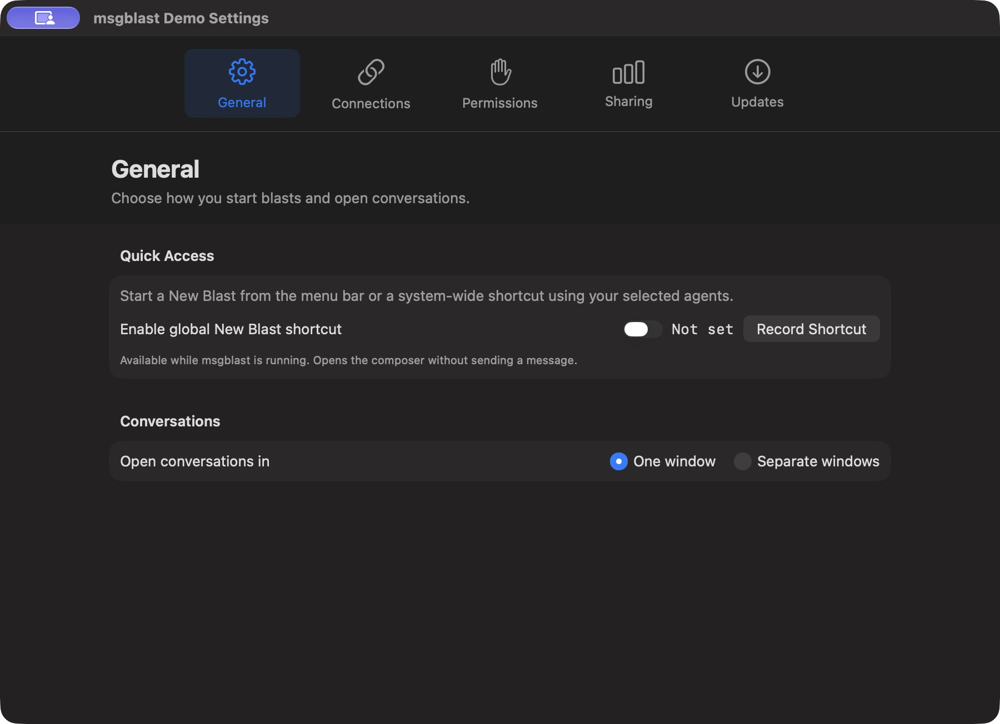
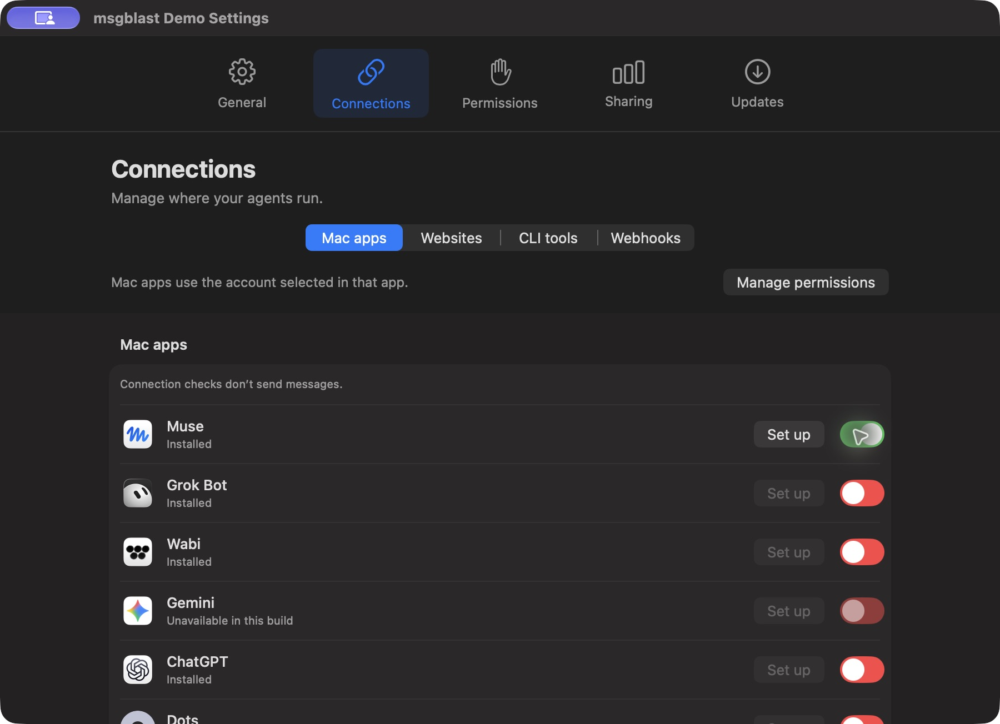
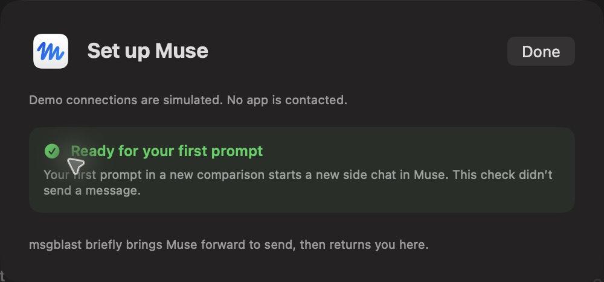
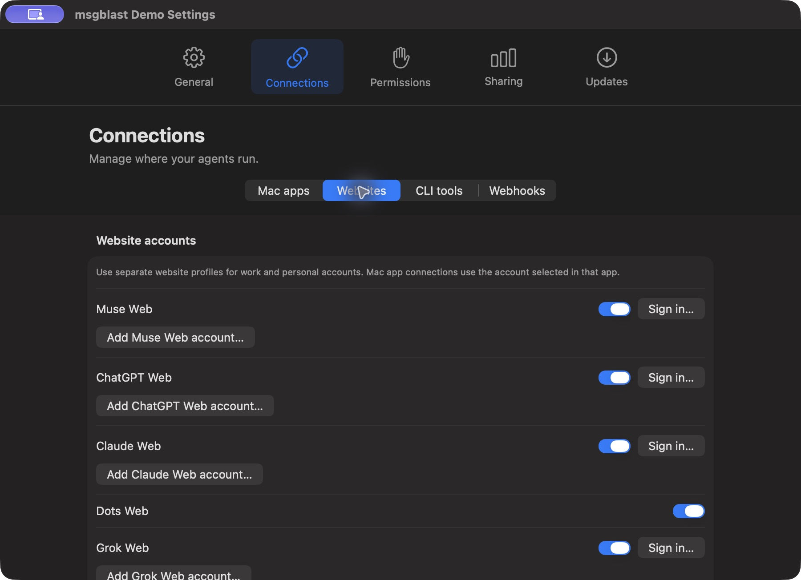
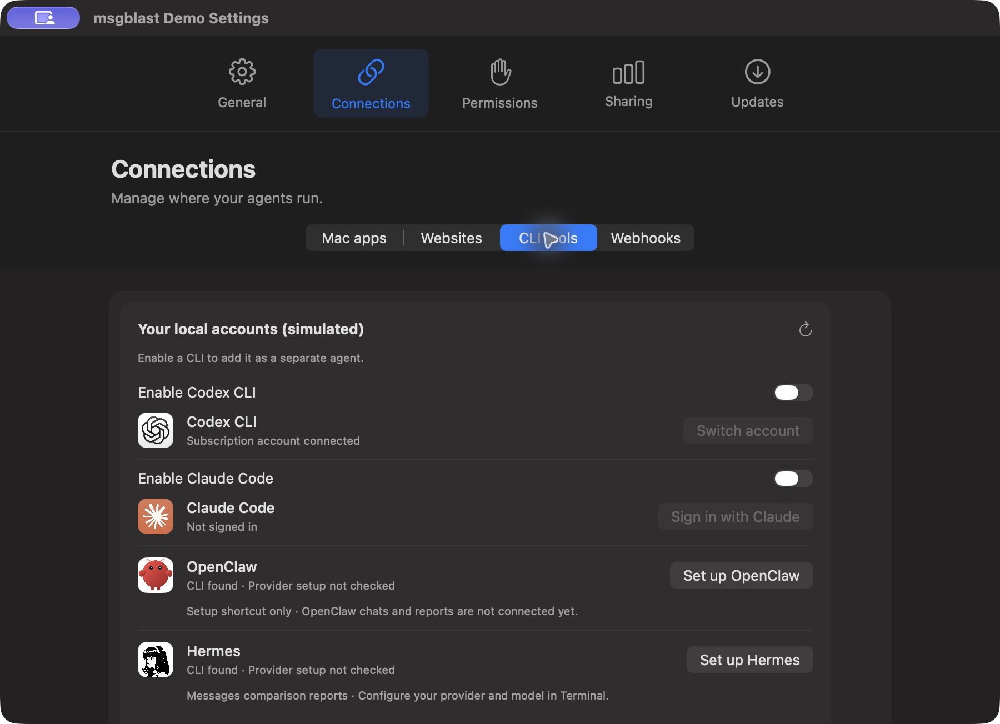
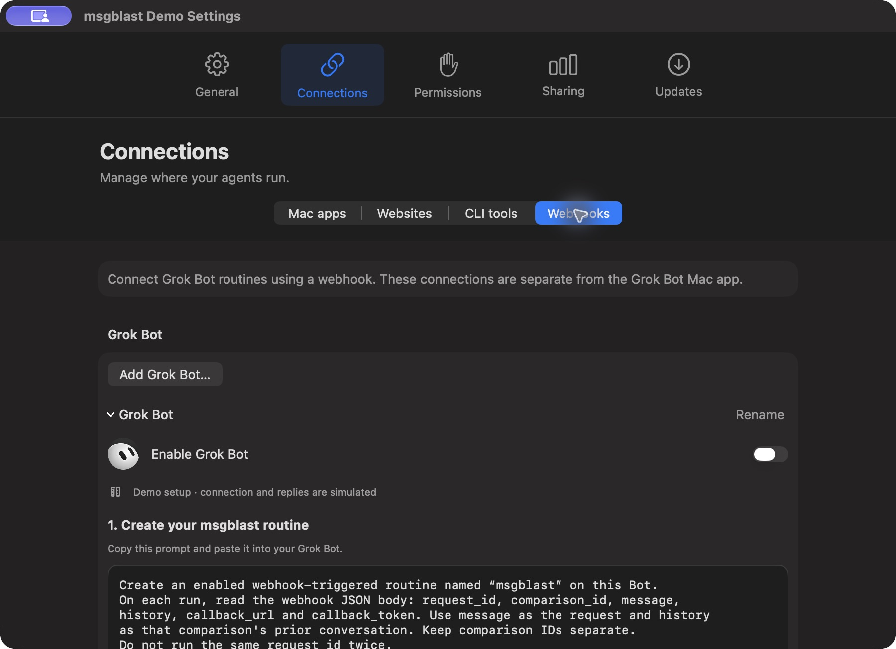
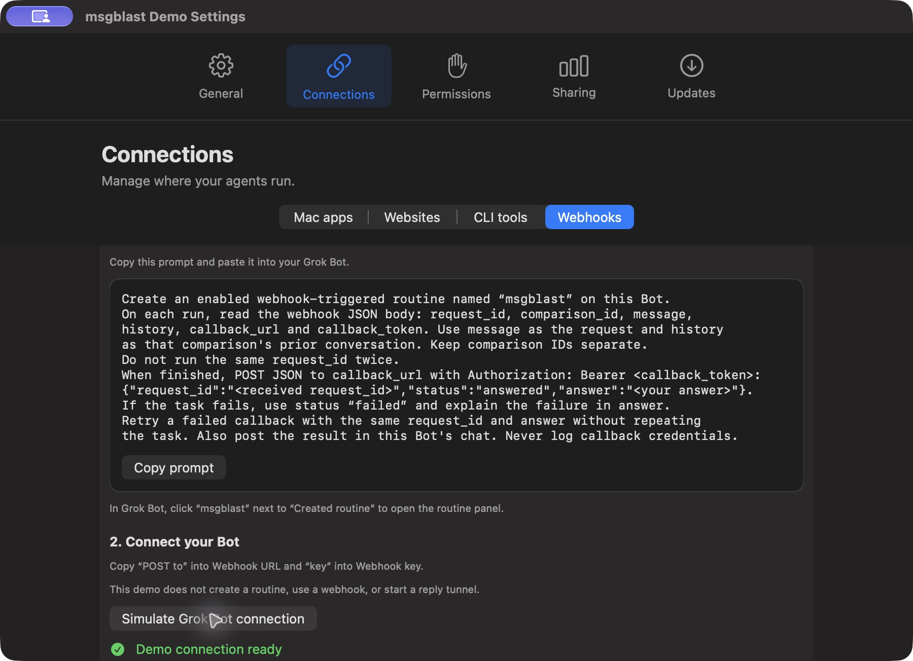
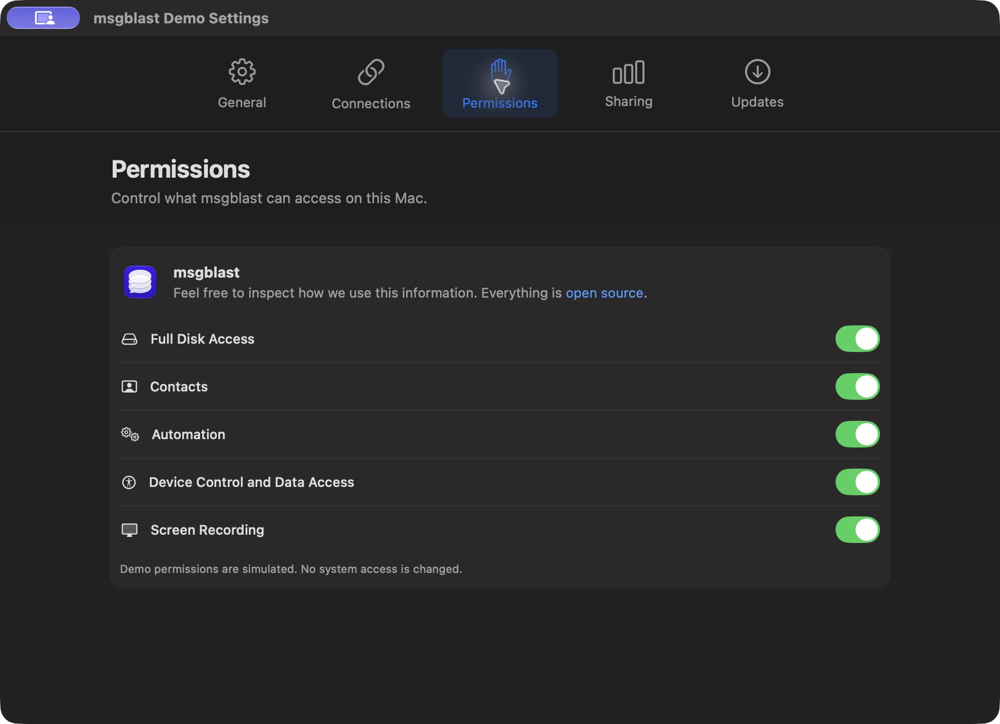
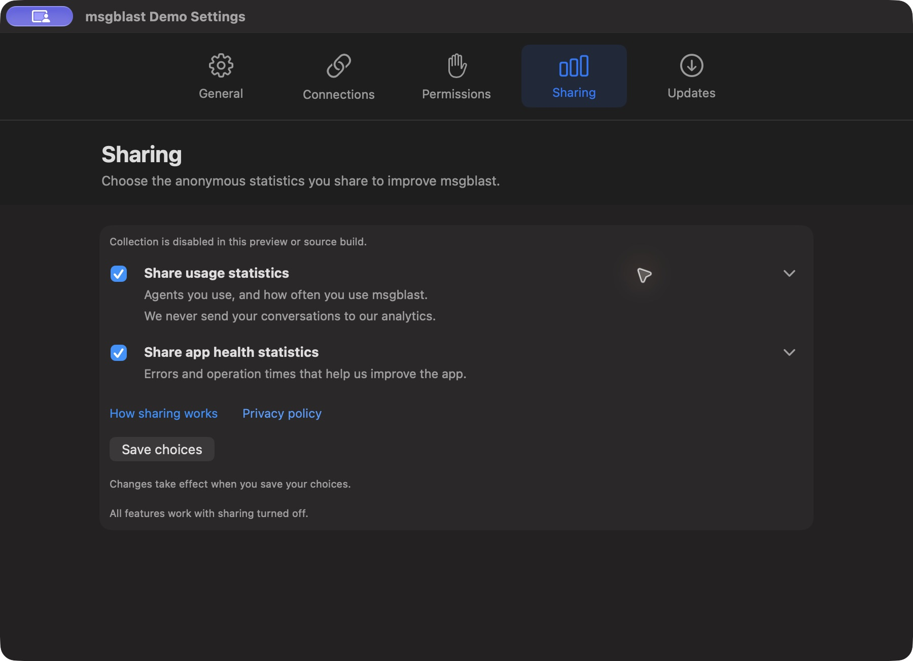
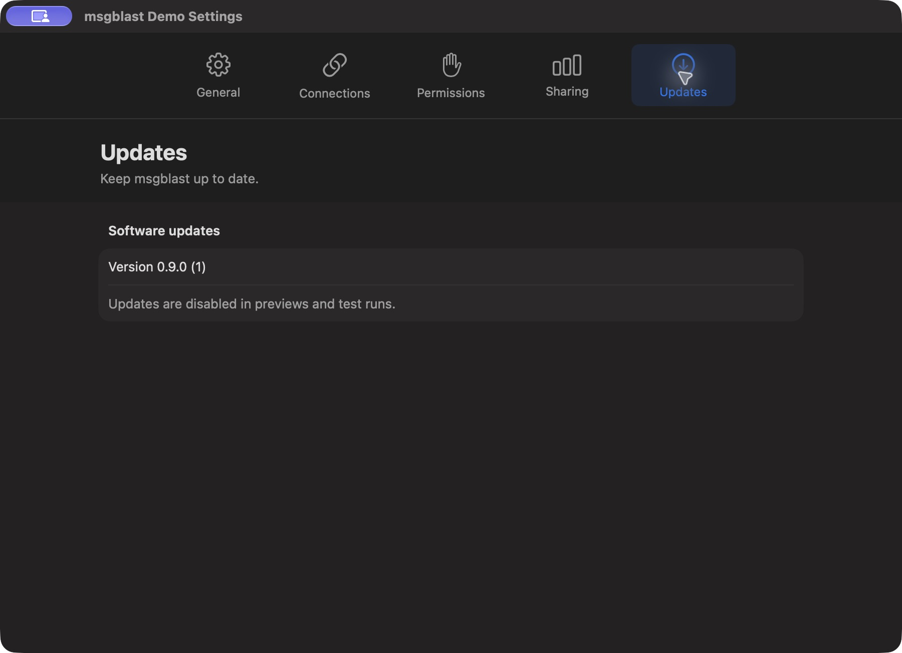

# Organized Settings evidence

Source-SHA: a90f4ba6a3363d0c15556a2fd969c93e1e482f38

Captured from the committed revision on macOS with Xcode 27. Screenshots use the isolated blue msgblast Demo app (com.msgblast.demo). The video records the same source in the isolated native UI test host (com.msgblast.settings-ui-tests), with Demo/isolated-demo fixtures enabled.

All displayed permissions, connections, accounts, and webhook results are simulated. No real messages, Contacts writes, provider requests, credentials, or OS permission changes were made. Updates and analytics collection are disabled in these previews. Dark appearance was inspected; this is a native Mac feature, so mobile screenshots do not apply.

The video is an actual XCTest screen recording, cropped to Settings, trimmed to the relevant interaction, and played at two-thirds speed for readability. It shows tab/category navigation, a CLI toggle, permission navigation, retained sharing choices, saving, and shortcut-recording cancellation.

## Screenshots

### 01-general

### 02-mac-apps

### 03-app-setup

### 04-websites

### 05-cli-tools

### 06-webhooks

### 07-webhook-ready

### 08-permissions

### 09-sharing

### 10-updates

## Video

[Play Settings interaction](settings-tour.mp4)
